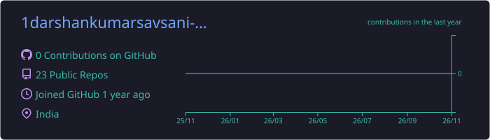
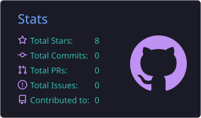
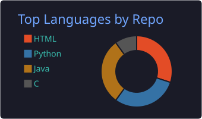
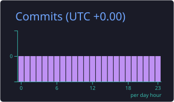

  

<h1 align="center">Hi there , I'm Darshankumar</h1>
<h3 align="center">Diploma Computer Engineering student · Builder of useful tools · Founder of <b>Darshan Corporation</b></h3>

  

---

### 🧑‍💻 About me
- 🎓 Studying **Diploma in Computer Engineering** at **Atmiya University**, Rajkot
- 🛠 I build small, fast tools that solve real problems
- 🤖 Exploring **AI tools**, automation and creative tech
- 🎵 I also make music: check my songs on YouTube as **savsanidarshankumar**
- 🌐 Portfolio: https://1darshankumarsavsani-blip.github.io/
- 📫 Reach me: **1darshankumarsavsani@gmail.com**

### 🚀 Featured projects

| Project | What it is | Tech |
|---|---|---|
| [**Darshan File Manager**](https://github.com/1darshankumarsavsani-blip/Darshan-File-Manager) | Tiny Windows app that auto-organizes Downloads/Desktop: sort by type or extension, date folders, Auto mode, undo | C · Win32 |
| [**Darshan File Manager for Android**](https://github.com/1darshankumarsavsani-blip/Darshan-File-Manager-Android) | Keeps your phone's Download folder clean, with background Auto mode | Java · Android |
| [**Student Planner**](https://github.com/1darshankumarsavsani-blip/Student-Planner) | Offline Android app: exams, syllabus, study timer, notes (Gujarati + English) | Java · Android |
| [**Khata Book**](https://github.com/1darshankumarsavsani-blip/Khata-Book) | Offline Android app: income/expense ledger and credit (udhar) | Java · Android |
| [**Vishwas**](https://github.com/1darshankumarsavsani-blip/Vishwas) | Milestone payment tracker for freelancers: client approves on a link, trust score for on-time delivery | Web |
| [**Bill Splitter**](https://github.com/1darshankumarsavsani-blip/Bill-Splitter) | Split group expenses and see who pays whom | Web |
| [**Habit Tracker**](https://github.com/1darshankumarsavsani-blip/Habit-Tracker) | Daily habits with streaks and a 7-day view | Web |
| [**EMI Calculator**](https://github.com/1darshankumarsavsani-blip/EMI-Calculator) | Loan EMI calculator with year-wise schedule | Web |

### 🏆 Certificates
Google AI Essentials · Google Prompting Essentials · HP LIFE · Anthropic Academy (Claude 101, Claude Code 101, Claude Platform 101, Cowork) · AI Foundation. Proof and verify links are on my portfolio.

### 🔗 Links

  
  
  
  

### 🧰 Languages & tools

  

  
  
  
  
  
  
  
  

### 📊 GitHub stats

  

  
  

  
  

### 🐍 Contribution snake

  <picture>
    <source media="(prefers-color-scheme: dark)" srcset="https://raw.githubusercontent.com/1darshankumarsavsani-blip/1darshankumarsavsani-blip/output/github-snake-dark.svg">
    <source media="(prefers-color-scheme: light)" srcset="https://raw.githubusercontent.com/1darshankumarsavsani-blip/1darshankumarsavsani-blip/output/github-snake.svg">
    
  </picture>

  

---

<i>"Build small. Ship often. Keep learning."</i> ⭐ Star a repo if you find it useful!

  

